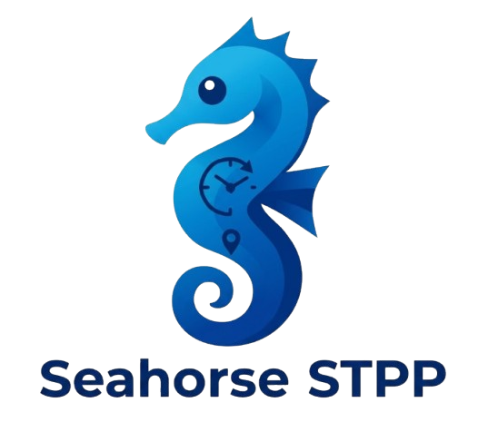

<div align="center">



A benchmark and library for spatio-temporal point processes: 13 datasets, 28 model presets, one evaluation protocol with exact likelihoods and calibration. NeurIPS 2026.

[](https://pypi.org/project/seahorse-stpp/)
[](https://doi.org/10.5281/zenodo.21078077)
[](LICENSE)
[](https://yahyaaalaila.github.io/seahorse/)

The Seahorse paper is accepted at NeurIPS 2026 (Track on Evaluations and Datasets); preprint: [arXiv:2607.01022](https://arxiv.org/abs/2607.01022).

</div>

---

| [News](#news) | [What's inside](#whats-inside) | [Quick Start](#quick-start) | [Supported models](#supported-models) | [Datasets](#datasets) | [CLI](#cli) | [Citation](#citation) | [License](#license) | [Acknowledgment](#acknowledgment) |

---

## 🗞️ News [[Back&nbsp;to&nbsp;Top](#top)]

- `v1.0.0`, the NeurIPS 2026 camera-ready release: corrected likelihood reporting, exact compensator-based evaluation and calibration, frozen campaigns and hash-verified datasets ([changelog](CHANGELOG.md)). `pip install seahorse-stpp`.
- The Seahorse paper is accepted at NeurIPS 2026 (Track on Evaluations and Datasets). Preprint: [arXiv:2607.01022](https://arxiv.org/abs/2607.01022).

<details>
<summary>More news</summary>

- **HawkesNest**, our synthetic STPP stress-test suite: [code](https://github.com/YahyaAalaila/HawkesNest) · [paper](https://arxiv.org/abs/2606.16863).
- [24-05-2025] Presentation at the [Machine Learning &amp; Global Health Network (MLGH)](https://mlgh.net/), London, UK.
- [01-04-2025] Our [knowledgebase website](https://events2025.github.io/) is up.
- [13-02-2025] Our review paper [Neural Spatiotemporal Point Processes: Trends and Challenges](https://arxiv.org/abs/2502.09341) is on arXiv.

</details>

---

## 🧭 What's inside [[Back&nbsp;to&nbsp;Top](#top)]

- **Models** — 28 presets: 10 neural STPPs from the literature, 11 parametric and 5 statistical baselines, and `dnsk`/`glide` ([table](#supported-models)).
- **Datasets** — the 13 benchmark datasets (10 real, 3 synthetic controls), the 3 legacy Neural-STPP splits and 3 further real datasets, on the Hugging Face Hub with pinned revisions and hash-verified splits ([list](#datasets)).
- **Evaluation** — next-event NLL with exact / quadrature / approximate labels; sampler-free calibration (time-rescaling PIT, threshold-weighted CRPS, spatial HPD-PIT) from the same compensator (`seahorse.evaluation.v1`).
- **Campaigns** — frozen multi-seed campaigns: `seahorse campaign` compiles, verifies, runs, calibrates and reports them, with Slurm dispatch.

---

## 🚀 Quick Start [[Back&nbsp;to&nbsp;Top](#top)]

```bash
pip install seahorse-stpp                 # pip install "seahorse-stpp[hpo]" adds Ray Tune HPO
```

```python
from seahorse import AutoSTPP, PoissonGMM, load_jsonl

train = load_jsonl("dataset_root/train.jsonl")
val   = load_jsonl("dataset_root/val.jsonl")
test  = load_jsonl("dataset_root/test.jsonl")

model    = AutoSTPP(device="cpu")
baseline = PoissonGMM()

model.fit(train, val, test, epochs=50, batch_size=64)
scores  = model.evaluate(test)          # {"test_nll": ..., "mean_seq_nll": ...}
samples = model.predict_next(test, n_samples=32)
```

Released datasets load by short name (see [Datasets](#datasets)):

```python
from seahorse.data import load_released_dataset
splits = load_released_dataset("nyc_collisions")   # {"train": [...], "val": [...], "test": [...], "__provenance__": [...]}
```

Guides: [Getting Started](https://yahyaaalaila.github.io/seahorse/getting-started/) ·
[Why Seahorse?](https://yahyaaalaila.github.io/seahorse/why-seahorse/) ·
[End-to-End Case Study](https://yahyaaalaila.github.io/seahorse/examples/case-study/) ·
[Predicting with Models](https://yahyaaalaila.github.io/seahorse/run-models/predict/)

<details>
<summary>Development install from source</summary>

*macOS / Linux:*

```bash
python -m venv .venv && source .venv/bin/activate
pip install -e ".[dev]"
```

*Windows:*

```powershell
python -m venv .venv
.\.venv\Scripts\activate
pip install -e ".[dev]"
```

</details>

**STPPRunner (lower-level)** — YAML-configured runs on PyTorch Lightning:

```python
from seahorse import STPPRunner

runner = STPPRunner.from_preset("auto_stpp")
result = runner.fit(train, val, test)   # returns RunResult
runner.save("/tmp/my_run/")

runner2 = STPPRunner.load("/tmp/my_run/")   # reloads config, normalisation and weights
# post-fit metrics: python -m seahorse evaluate metrics --run /tmp/my_run --data dataset_root/test.jsonl
```

---

## 🤖 Supported models [[Back&nbsp;to&nbsp;Top](#top)]

Neural presets benchmarked in the paper:

| No | Venue      | Preset                                  | Paper                                                                                            | Implementation |
| :-: | ---------- | --------------------------------------- | ------------------------------------------------------------------------------------------------ | :------------: |
| 1 | NeurIPS'23 | `auto_stpp`                           | [Automatic Integration for Spatiotemporal Neural Point Processes](https://arxiv.org/abs/2310.01179) |    PyTorch    |
| 2 | L4DC'22    | `deep_stpp`                           | [Neural Point Process for Learning Spatiotemporal Event Dynamics](https://proceedings.mlr.press/v168/zhou22a.html) (DeepSTPP) |    PyTorch    |
| 3 | ICLR'21    | `neural_jumpcnf` / `neural_attncnf` | [Neural Spatio-Temporal Point Processes](https://openreview.net/forum?id=XQQA6-So14)                |    PyTorch    |
| 4 | ICLR'21    | `njsde` (alias `neural_stpp_gmm`)     | [Neural Spatio-Temporal Point Processes](https://openreview.net/forum?id=XQQA6-So14): jump-ODE state model with the conditional-GMM spatial decoder (the preset id is historical; this is not Jia & Benson's Neural Jump SDE) |    PyTorch    |
| 5 | ACM KDD'23 | `diffusion_stpp`                      | [Spatio-temporal Diffusion Point Processes](https://dl.acm.org/doi/10.1145/3580305.3599511)         |    PyTorch    |
| 6 | ICLR'22    | `nsmpp`                               | [Neural Spectral Marked Point Processes](https://openreview.net/forum?id=0rcbOaoBXbg)               |    PyTorch    |
| 7 | arXiv      | `smash`                               | [Embedding Event History to Vector](https://arxiv.org/abs/2310.19324)                               |    PyTorch    |
| 8 | ICML'20    | `thp_gmm`                             | [Transformer Hawkes Process](https://arxiv.org/abs/2002.09291)                                      |    PyTorch    |
| 9 | KDD'16     | `rmtpp_gmm`                           | [Recurrent Marked Temporal Point Processes](https://dl.acm.org/doi/10.1145/2939672.2939875)         |    PyTorch    |

**Parametric baselines** (closed-form likelihood):
`poisson_gmm` · `hawkes_gmm` · `selfcorrecting_gmm` · `poisson_cnf` · `hawkes_cnf` · `selfcorrecting_cnf` · `poisson_tvcnf` · `hawkes_tvcnf` · `selfcorrecting_tvcnf` · `static_hawkes` · `gaussian_poisson`

**Statistical presets** (NumPy/SciPy, CPU, no gradient training):
`homogeneous_poisson` · `spatial_poisson` · `seasonal_poisson` · `hawkes_exp_gaussian` · `hawkes_omori_pareto`

**Available, not benchmarked in the paper:** `dnsk` (DNSK+Barrier, Dong et al. ICLR'23) · `glide` (GLIDE, diffusion objective, no point-process NLL).

NLL labels: NSMPP and THP-GMM evaluate their density directly and integrate the compensator by numerical quadrature; SMASH and DSTPP report approximate values (sample-based estimates, not likelihood bounds). See the [capability matrix](https://yahyaaalaila.github.io/seahorse/model-capability-matrix/).

---

## 📊 Datasets [[Back&nbsp;to&nbsp;Top](#top)]

Seahorse reads any collection of JSONL event sequences. The canonical split layout is:

```text
dataset_root/
  train.jsonl
  val.jsonl
  test.jsonl
```

Each line is one sequence:

```json
{"times": [0.1, 0.4, 1.2], "locations": [[0.2, 0.4], [0.3, 0.8], [0.7, 0.1]]}
```

The datasets are released under the [`seahorse-stpp`](https://huggingface.co/seahorse-stpp) Hugging Face organisation (17 repositories: 16 real datasets and the synthetic controls) and load by short name with pinned revisions and card-hash verification:

```python
from seahorse.data import load_released_dataset
splits = load_released_dataset("austin311")      # {"train": [...], "val": [...], "test": [...], "__provenance__": [...]}
```

- **Real-data benchmark (paper)** — `comcat_california`, `geonet_nz`, `austin311`, `nyc311`, `nyc_collisions`, `chicago_crime`, `la_crime`, `uber_nyc`, plus the script-only `seattle_fire911` and `citibike_nyc`.
- **Synthetic controls (paper)** — `synthetic` (homogeneous Poisson, moving seasonal Poisson, gamma renewal).
- **Legacy Neural-STPP splits** — `earthquakes` ([USGS](https://earthquake.usgs.gov/)), `covid` ([New York Times](https://github.com/nytimes/covid-19-data)), `citibike_legacy` (script-only).
- **Released, not benchmarked in the paper** — `bold5000`, `us_wildfires`, `us_accidents`.

The three script-only repositories cannot host their data under the source licences; they ship a rebuild script and the expected split hashes, and `load_released_dataset(name, local_root=...)` verifies a local rebuild against the card. Any other JSONL dataset on the [Hugging Face Hub](https://huggingface.co/datasets) loads via `--dataset owner/repo`.

For the complete catalog see the [Datasets Documentation](https://yahyaaalaila.github.io/seahorse/datasets/catalog/).

---

## 💻 CLI [[Back&nbsp;to&nbsp;Top](#top)]

**Fit one model**

```bash
python -m seahorse fit \
  --preset auto_stpp \
  --train dataset_root/train.jsonl \
  --val   dataset_root/val.jsonl \
  --test  dataset_root/test.jsonl \
  --out   runs/quickstart
```

**Benchmark** (multi-preset × multi-seed)

```bash
python -m seahorse bench \
  --presets auto_stpp deep_stpp njsde poisson_gmm \
  --splits_dir splits/ \
  --seeds 1 2 3 \
  --out runs/bench \
  --n_workers 4
```

**HPO sweep** (Ray Tune; `pip install "seahorse-stpp[hpo]"`)

```bash
python -m seahorse tune \
  --config configs/auto_stpp_hpo.yaml \
  --train dataset_root/train.jsonl \
  --val   dataset_root/val.jsonl \
  --out   runs/hpo/best.yaml
```

The search space lives in the YAML's `tuning:` block (`{min: .., max: ..}` ranges and choice lists).

**Frozen campaign** (the paper's protocol; specs under `experiments/campaign_2026/`)

```bash
python -m seahorse campaign prepare --spec experiments/campaign_2026/spec_v1.json --out campaigns/v1
python -m seahorse campaign --help     # verify, preflight, run, evaluate, calibrate, report, slurm
```

---

## 📝 Citation [[Back&nbsp;to&nbsp;Top](#top)]

If Seahorse supports your work, please cite the paper:

```bibtex
@inproceedings{aalaila2026seahorse,
  title     = {Seahorse: A Unified Benchmarking Framework for Spatiotemporal Event Modeling},
  author    = {Aalaila, Yahya and Vollmer, Sebastian and Gro{\ss}mann, Gerrit},
  booktitle = {Advances in Neural Information Processing Systems (NeurIPS 2026), Track on Evaluations and Datasets},
  year      = {2026},
  note      = {Preprint: arXiv:2607.01022}
}
```

To cite the software release, use the Zenodo concept DOI (it resolves to the latest version):

```bibtex
@software{seahorse2026,
  title   = {Seahorse: Unified Benchmarking for Spatio-Temporal Point Processes},
  author  = {Aalaila, Yahya and Gro{\ss}mann, Gerrit and Vollmer, Sebastian},
  year    = {2026},
  version = {1.0.0},
  doi     = {10.5281/zenodo.21078077},
  url     = {https://github.com/YahyaAalaila/seahorse},
  license = {Apache-2.0}
}
```

GitHub's **Cite this repository** button (from [`CITATION.cff`](CITATION.cff)) offers these entries in APA and BibTeX.

---

## ⚖️ License [[Back&nbsp;to&nbsp;Top](#top)]

Seahorse is distributed under the **Apache License 2.0**. See [LICENSE](LICENSE) and [NOTICE](NOTICE).

**Licensing.** Apache-2.0, except the CNF spatial decoder (`seahorse/models/spatial_models/independent_cnf.py`), which is adapted from [neural_stpp](https://github.com/facebookresearch/neural_stpp) and remains under CC BY-NC 4.0 (non-commercial). The vendored Hawkes source under `seahorse/models/statistical/_hawkes_source/` is MIT.

---

## 🙏 Acknowledgment [[Back&nbsp;to&nbsp;Top](#top)]

**Funding.** The authors received support from the Bundesministerium für Bildung und Forschung (BMBF) under Grant No. 01W23005 for the project EVENTFUL.

**Contributors.** Beyond the authors, we thank Ismail Drief and Raphael Sonabend-Friend for their contributions to the codebase and its early design.

**Upstream implementations.** Seahorse builds on the original implementations of the paper families it wraps. We thank the authors of AutoSTPP, DeepSTPP, Neural STPP, DiffusionSTPP, NSMPP, SMASH, THP, and RMTPP for releasing their code.
