# Dataset cards

13 real datasets · HawkesNest entanglement suite · released extras

The NeurIPS 2026 paper benchmarks 19 presets on **13 real datasets**: ten with chronological train/validation/test splits and the three datasets of the Neural STPP benchmark (COVID, Earthquakes, Citi Bike daily) under their original splits. The **HawkesNest entanglement suite** is the controlled synthetic stress test. All are on the Hugging Face Hub under [`seahorse-stpp`](https://huggingface.co/seahorse-stpp), pinned to a release revision and verified against the card hashes on load. Three repositories are script-only: they rebuild the data from the source instead of hosting it.

Each card shows where and when the events fall, the split sizes, the licence, how to load the data and the best presets of the paper.

## Real data, chronological splits

<a class="sh-ds-card sh-ds-card--bench" href="cards/comcat_california/">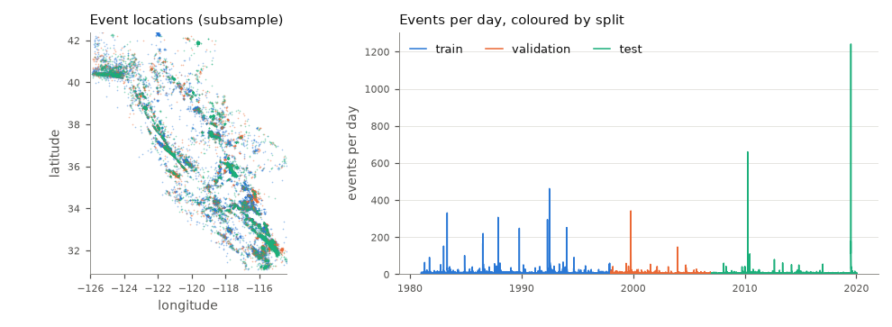ComCat · Californiapaper<code class="sh-ds-id">comcat_california</code>Earthquakes in California (USGS ANSS ComCat, as packaged by EarthquakeNPP).77,331 events · 14,260 sequences</a>
<a class="sh-ds-card sh-ds-card--bench" href="cards/geonet_nz/">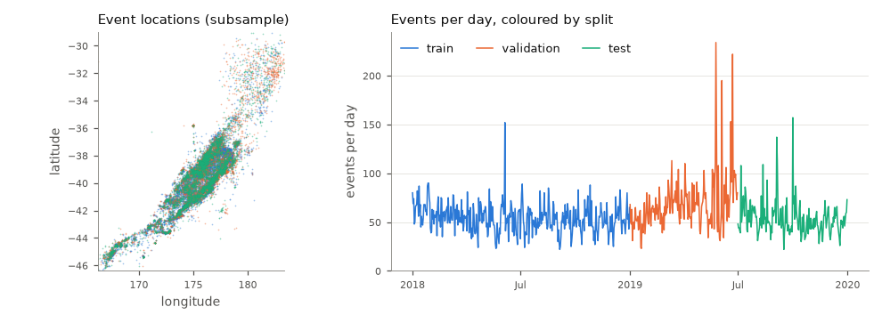GeoNet · New Zealandpaper<code class="sh-ds-id">geonet_nz</code>Earthquakes in New Zealand (GeoNet catalogue).42,000 events · 730 sequences</a>
<a class="sh-ds-card sh-ds-card--bench" href="cards/citibike_nyc/">rebuild scriptCiti Bike · hourlypaperscript-only<code class="sh-ds-id">citibike_nyc</code>Bike-share trip starts in New York City, hourly sequences.</a>
<a class="sh-ds-card sh-ds-card--bench" href="cards/austin311/">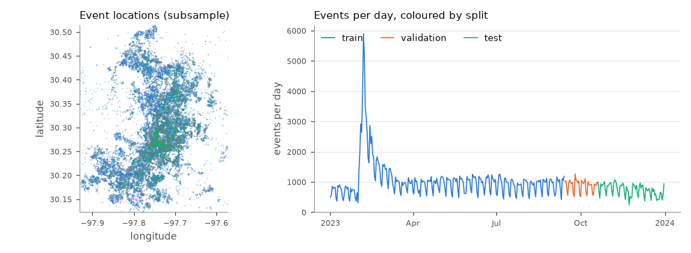Austin 311paper<code class="sh-ds-id">austin311</code>311 service requests in Austin, Texas.352,977 events · 365 sequences</a>
<a class="sh-ds-card sh-ds-card--bench" href="cards/seattle_fire911/">rebuild scriptSeattle fire 911paperscript-only<code class="sh-ds-id">seattle_fire911</code>Fire-department 911 dispatches in Seattle.</a>
<a class="sh-ds-card sh-ds-card--bench" href="cards/nyc311/">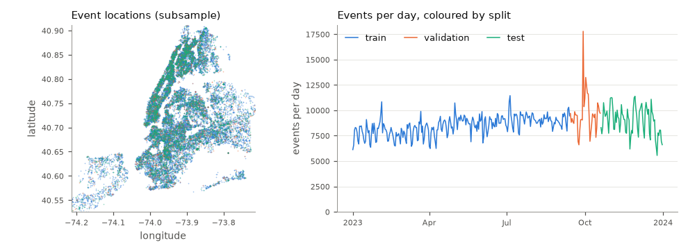NYC 311paper<code class="sh-ds-id">nyc311</code>311 service requests in New York City.3,176,144 events · 365 sequences</a>
<a class="sh-ds-card sh-ds-card--bench" href="cards/nyc_collisions/">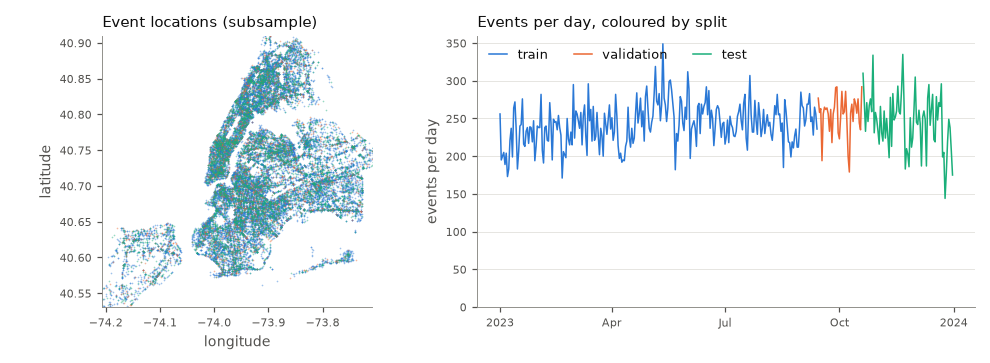NYC collisionspaper<code class="sh-ds-id">nyc_collisions</code>Police-reported motor-vehicle collisions in New York City.89,014 events · 365 sequences</a>
<a class="sh-ds-card sh-ds-card--bench" href="cards/chicago_crime/">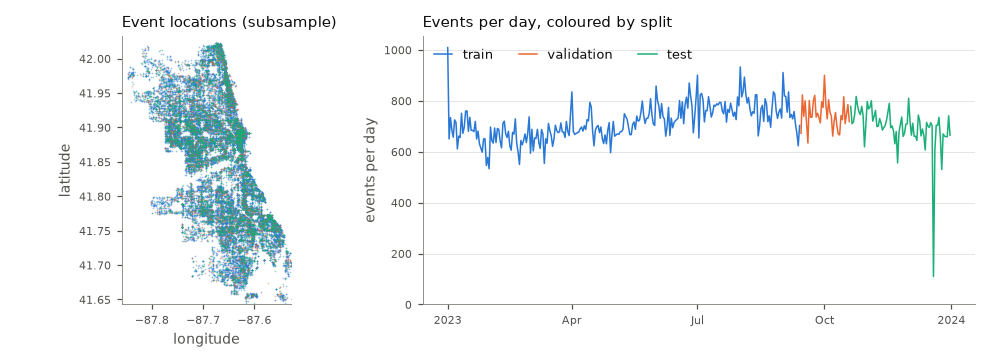Chicago crimepaper<code class="sh-ds-id">chicago_crime</code>Crime reports in Chicago.261,244 events · 365 sequences</a>
<a class="sh-ds-card sh-ds-card--bench" href="cards/la_crime/">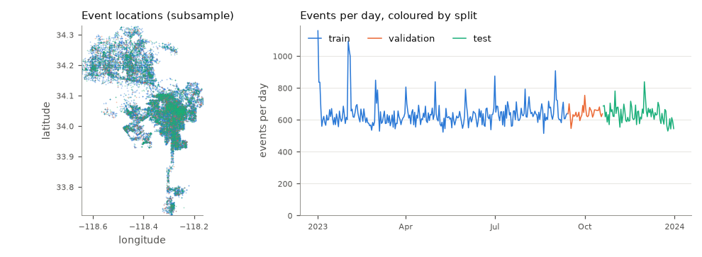LA crimepaper<code class="sh-ds-id">la_crime</code>Crime reports in Los Angeles.232,341 events · 365 sequences</a>
<a class="sh-ds-card sh-ds-card--bench" href="cards/uber_nyc/">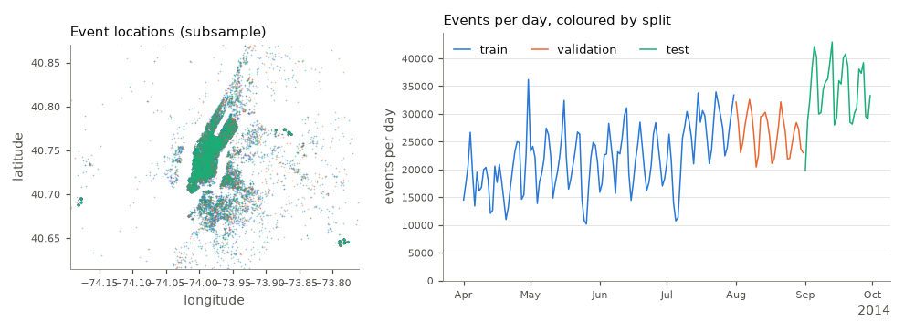Uber pickups · NYCpaper<code class="sh-ds-id">uber_nyc</code>Ride-hailing pickups in New York City.4,513,058 events · 4,391 sequences</a>

## Real data, Neural STPP benchmark splits

<a class="sh-ds-card sh-ds-card--bench" href="cards/covid/">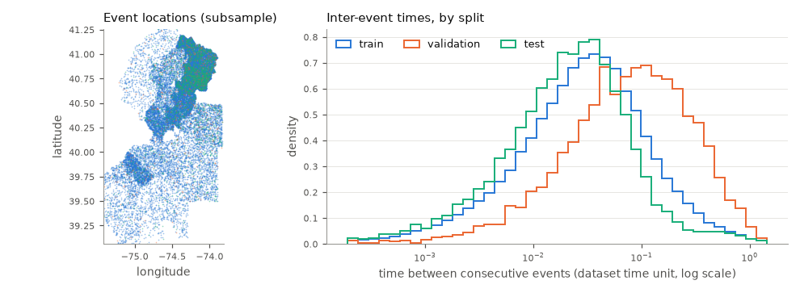COVID-19 · New JerseypaperNeural STPP split<code class="sh-ds-id">covid</code>COVID-19 case reports in New Jersey counties (The New York Times).161,542 events · 1,650 sequences</a>
<a class="sh-ds-card sh-ds-card--bench" href="cards/earthquakes/">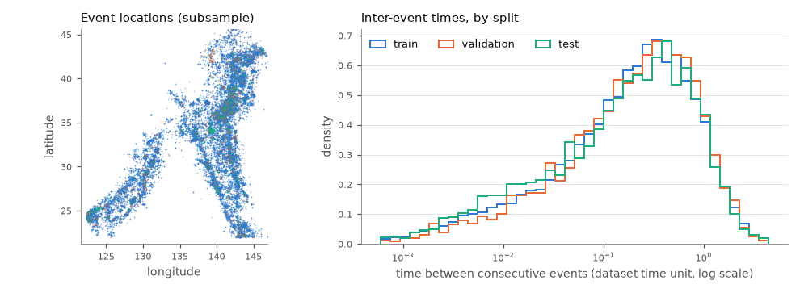Earthquakes · JapanpaperNeural STPP split<code class="sh-ds-id">earthquakes</code>Earthquakes of magnitude ≥ 2.5 around Japan (USGS ComCat).79,840 events · 1,050 sequences</a>
<a class="sh-ds-card sh-ds-card--bench" href="cards/citibike_legacy/">rebuild scriptCiti Bike · dailypaperNeural STPP splitscript-only<code class="sh-ds-id">citibike_legacy</code>Bike-share trip starts in New York City, daily sequences (thinned, Neural STPP construction).</a>

## Synthetic stress test

<a class="sh-ds-card sh-ds-card--bench" href="cards/hawkesnest_entanglement/">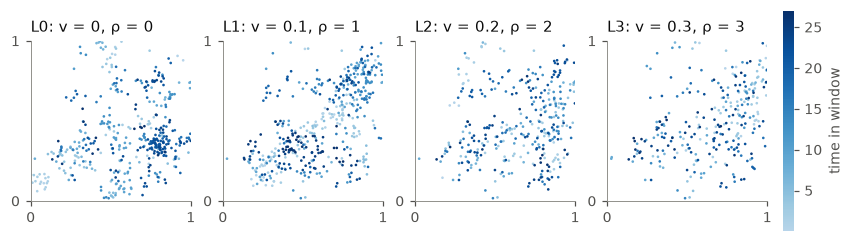HawkesNest entanglement suitepapersynthetic<code class="sh-ds-id">hawkesnest_entanglement</code>Spatiotemporal Hawkes process on the unit square with tunable space–time coupling, levels L0–L3.44,129 events · 110 sequences</a>

## Released, not benchmarked in the paper

<a class="sh-ds-card" href="cards/synthetic/">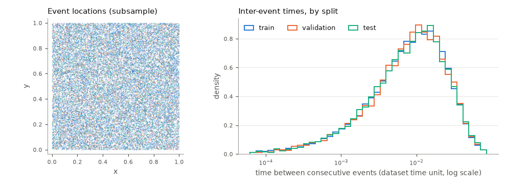Synthetic controlssyntheticnot benchmarked<code class="sh-ds-id">synthetic</code>Homogeneous Poisson, moving seasonal Poisson and gamma renewal processes on the unit square.61,198 events · 768 sequences</a>
<a class="sh-ds-card" href="cards/bold5000/">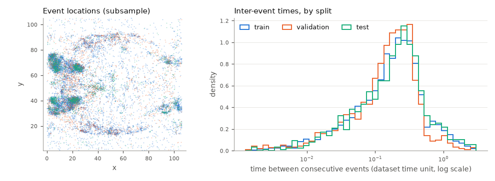BOLD5000not benchmarked<code class="sh-ds-id">bold5000</code>Eventized responses derived from BOLD5000 fMRI recordings (space is not geographic).13,138 events · 100 sequences</a>
<a class="sh-ds-card" href="cards/us_wildfires/">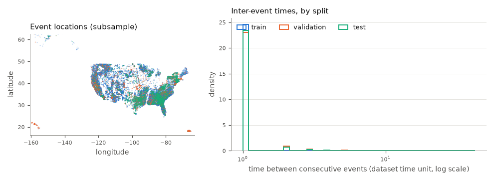US wildfiresnot benchmarked<code class="sh-ds-id">us_wildfires</code>Wildfire ignitions in the United States (USFS RDS-2013-0009.4).1,880,465 events · 18,806 sequences</a>
<a class="sh-ds-card" href="cards/us_accidents/">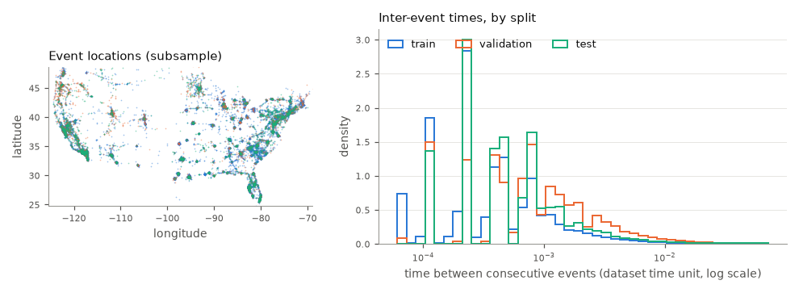US traffic accidentsnot benchmarked<code class="sh-ds-id">us_accidents</code>Road traffic accident reports in the United States (Moosavi et al.).6,985,228 events · 69,854 sequences</a>

## Summary table

| Dataset | Short name | Paper column | Period and splits | Sequences (train / val / test) | Events | Licence | Hosted |
| --- | --- | --- | --- | --- | ---: | --- | --- |
| [ComCat · California](cards/comcat_california.md) | `comcat_california` | ComCat | 1981–2020; validation from 1998, test from 2007 | 6,209 / 3,287 / 4,764 | 77,331 | public domain (USGS ANSS ComCat) | yes |
| [GeoNet · New Zealand](cards/geonet_nz.md) | `geonet_nz` | GeoNet | 2018–2020; validation from 2019-01, test from 2019-07 | 365 / 181 / 184 | 42,000 | CC BY 3.0 NZ (GeoNet) | yes |
| [Citi Bike · hourly](cards/citibike_nyc.md) | `citibike_nyc` | Citi Bike (h) | 2019-04 – 2019-08; validation from 08-01, test from 08-16 | see card | see card | script MIT; data under the Citi Bike data licence, not hosted | script |
| [Austin 311](cards/austin311.md) | `austin311` | Austin | 2023; validation from 09-14, test from 10-20 | 256 / 36 / 73 | 352,977 | public domain (City of Austin) | yes |
| [Seattle fire 911](cards/seattle_fire911.md) | `seattle_fire911` | Seattle | 2023; validation from 09-14, test from 10-20 | see card | see card | script MIT; data public domain (City of Seattle), not hosted | script |
| [NYC 311](cards/nyc311.md) | `nyc311` | NYC 311 | 2023; validation from 09-14, test from 10-20 | 256 / 36 / 73 | 3,176,144 | NYC Open Data terms of use | yes |
| [NYC collisions](cards/nyc_collisions.md) | `nyc_collisions` | NYC coll. | 2023; validation from 09-14, test from 10-20 | 256 / 36 / 73 | 89,014 | NYC Open Data terms of use | yes |
| [Chicago crime](cards/chicago_crime.md) | `chicago_crime` | Chicago | 2023; validation from 09-14, test from 10-20 | 256 / 36 / 73 | 261,244 | City of Chicago data terms of use | yes |
| [LA crime](cards/la_crime.md) | `la_crime` | LA | 2023; validation from 09-14, test from 10-20 | 256 / 36 / 73 | 232,341 | CC0 1.0 (LAPD) | yes |
| [Uber pickups · NYC](cards/uber_nyc.md) | `uber_nyc` | Uber | 2014-04 – 2014-09; validation from 08-01, test from 09-01 | 2,928 / 744 / 719 | 4,513,058 | CC0 1.0 (FiveThirtyEight / NYC TLC FOIL) | yes |
| [COVID-19 · New Jersey](cards/covid.md) | `covid` | COVID | 2020-03 – 2020-07; original Neural STPP split | 1,450 / 100 / 100 | 161,542 | CC BY-NC 4.0 (The New York Times) | yes |
| [Earthquakes · Japan](cards/earthquakes.md) | `earthquakes` | Earthquakes | 1990–2019; original Neural STPP split | 950 / 50 / 50 | 79,840 | public domain (USGS) | yes |
| [Citi Bike · daily](cards/citibike_legacy.md) | `citibike_legacy` | Citi Bike (d) | 2019-04 – 2019-08; original Neural STPP split | see card | see card | script MIT; data under the Citi Bike data licence, not hosted | script |
| [HawkesNest entanglement suite](cards/hawkesnest_entanglement.md) | `hawkesnest_entanglement` | – | ten realizations of 8,000 events per level, cut into 20 windows each | 80 / 10 / 20 | 44,129 | CC BY 4.0 (Seahorse, HawkesNest) | yes |
| [Synthetic controls](cards/synthetic.md) | `synthetic` | – | independent windows on [0, 1) | 512 / 128 / 128 | 61,198 | CC BY 4.0 (Seahorse) | yes |
| [BOLD5000](cards/bold5000.md) | `bold5000` | – | see card | 70 / 10 / 20 | 13,138 | CC0 1.0 | yes |
| [US wildfires](cards/us_wildfires.md) | `us_wildfires` | – | see card | 13,164 / 2,821 / 2,821 | 1,880,465 | USFS RDS-2013-0009.4 (no permission required) | yes |
| [US traffic accidents](cards/us_accidents.md) | `us_accidents` | – | see card | 48,363 / 11,441 / 10,050 | 6,985,228 | CC BY-NC-SA 4.0 (Moosavi et al.) | yes |

Counts are for the default configuration; the HawkesNest row counts level L0. Regenerate this page and the cards with `python docs/_scripts/make_dataset_cards.py`.
