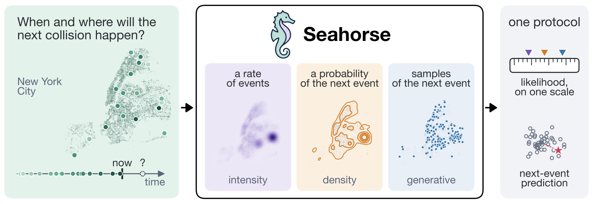
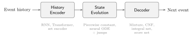
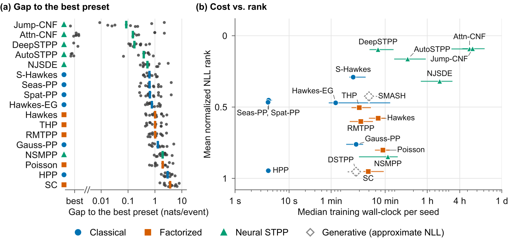

---
hide:
  - toc
---

# Seahorse

<p class="hero-tagline">
A benchmark and library for spatio-temporal point processes:<br>
13 real datasets, a controlled synthetic suite, 28 model presets (19 benchmarked in the paper),
one evaluation protocol with exact likelihoods and calibration.
</p>

<figure class="sh-figure" markdown="0">
  
  <figcaption>Models that answer the same question, when and where the next event occurs, with an event rate, a probability density or samples, are trained and evaluated under one protocol and compared on a common scale. Figure from the NeurIPS 2026 paper (Fig. 1).</figcaption>
</figure>

Seahorse couples declarative YAML configuration with PyTorch Lightning
execution, Ray Tune hyper-parameter optimisation, and versioned run artifacts
for reproducible benchmarking of event data. The Seahorse paper is accepted at
NeurIPS E&D 2026; see [Cite Seahorse](cite.md).

<div class="sh-home-grid" markdown="0">
<a class="sh-home-card sh-home-card--primary" href="python-api/">
  <span class="sh-home-top"><span class="sh-home-icon"><svg viewBox="0 0 24 24" aria-hidden="true"><path d="M10 16.5v-9l6 4.5M12 2A10 10 0 0 0 2 12a10 10 0 0 0 10 10 10 10 0 0 0 10-10A10 10 0 0 0 12 2"/></svg></span><span class="sh-home-title">Run One Model</span></span>
  <code class="sh-home-handle">model.fit(train, val, test)</code>
  <span class="sh-home-desc">Fit, evaluate, and sample from any registered model through a consistent Python API.</span>
  <span class="sh-home-foot">Python API <span class="sh-home-arrow" aria-hidden="true">→</span></span>
</a>
<a class="sh-home-card" href="benchmarks/">
  <span class="sh-home-top"><span class="sh-home-icon"><svg viewBox="0 0 24 24" aria-hidden="true"><path d="M22 21H2V3h2v16h2v-2h4v2h2v-3h4v3h2v-2h4zm-4-7h4v2h-4zm-6-8h4v3h-4zm4 9h-4v-5h4zM6 10h4v2H6zm4 6H6v-3h4z"/></svg></span><span class="sh-home-title">Run a Benchmark</span></span>
  <code class="sh-home-handle">python -m seahorse bench</code>
  <span class="sh-home-desc">Compare presets across datasets and seeds from one CLI command with saved, reproducible artifacts.</span>
  <span class="sh-home-foot">Run a Benchmark <span class="sh-home-arrow" aria-hidden="true">→</span></span>
</a>
<a class="sh-home-card" href="evaluation/">
  <span class="sh-home-top"><span class="sh-home-icon"><svg viewBox="0 0 24 24" aria-hidden="true"><path d="M9.5 3A6.5 6.5 0 0 1 16 9.5c0 1.61-.59 3.09-1.56 4.23l.27.27h.79l5 5-1.5 1.5-5-5v-.79l-.27-.27A6.52 6.52 0 0 1 9.5 16 6.5 6.5 0 0 1 3 9.5 6.5 6.5 0 0 1 9.5 3m0 2C7 5 5 7 5 9.5S7 14 9.5 14 14 12 14 9.5 12 5 9.5 5"/></svg></span><span class="sh-home-title">Evaluate Results</span></span>
  <code class="sh-home-handle">model.evaluate(test)</code>
  <span class="sh-home-desc">Run metric profiles — likelihood, predictive, surface — on any saved run directory.</span>
  <span class="sh-home-foot">Evaluation Guide <span class="sh-home-arrow" aria-hidden="true">→</span></span>
</a>
<a class="sh-home-card" href="adding-a-model/">
  <span class="sh-home-top"><span class="sh-home-icon"><svg viewBox="0 0 24 24" aria-hidden="true"><path d="M19 19V5H5v14zm0-16a2 2 0 0 1 2 2v14a2 2 0 0 1-2 2H5a2 2 0 0 1-2-2V5a2 2 0 0 1 2-2zm-8 4h2v4h4v2h-4v4h-2v-4H7v-2h4z"/></svg></span><span class="sh-home-title">Add Your Model</span></span>
  <code class="sh-home-handle">@ConfigRegistry.register(...)</code>
  <span class="sh-home-desc">Register a preset and your model works with fit, bench, and the metric profiles without changing import paths.</span>
  <span class="sh-home-foot">Developer Guide <span class="sh-home-arrow" aria-hidden="true">→</span></span>
</a>
</div>

## What Seahorse Provides

| Capability | What it gives you |
| --- | --- |
| **Unified Python API** | Train, evaluate, and sample any supported model through one interface. |
| **YAML-driven experiments** | Keep hyperparameters, data paths, and run settings explicit and reproducible. |
| **Model presets** | Switch among AutoSTPP, DeepSTPP, neural CNF families, diffusion models, NSMPP, SMASH, THP, RMTPP, and parametric baselines. |
| **Benchmark campaigns** | Run multi-preset, multi-dataset, multi-seed evaluations with comparable metrics. |
| **Artifact-backed evaluation** | Save run directories, metric tables, predictive samples, and surface diagnostics for later inspection. |

## Quick Start

=== "Python API"

    ```python
    from seahorse import AutoSTPP, PoissonGMM, load_jsonl

    train = load_jsonl("dataset_root/train.jsonl")
    val   = load_jsonl("dataset_root/val.jsonl")
    test  = load_jsonl("dataset_root/test.jsonl")

    model    = AutoSTPP(device="cpu")
    baseline = PoissonGMM()

    model.fit(train, val, test, epochs=50, batch_size=64)
    scores  = model.evaluate(test)
    samples = model.predict_next(test, n_samples=32)
    ```

=== "CLI"

    ```bash
    python -m seahorse fit \
      --preset auto_stpp \
      --train dataset_root/train.jsonl \
      --val   dataset_root/val.jsonl \
      --test  dataset_root/test.jsonl \
      --out   runs/quickstart
    ```

## Benchmarking Workflow

Every model is expressed as a history encoder, a state evolution and a decoder; families differ in
what fills each slot, not in how they are trained, tuned and scored.

<figure class="sh-figure sh-figure--narrow" markdown="0">
  
  <figcaption>Unified model decomposition: every benchmarked method instantiates these three components. Figure from the NeurIPS 2026 paper (Fig. 2).</figcaption>
</figure>

Seahorse reads JSONL event-sequence splits from local files or the released Hugging Face
datasets. Every benchmark run applies a shared data contract, so models are evaluated on the same
train, validation and test splits, the same target events and the same metric definitions, with
likelihoods reported in raw coordinates ([execution contract](learn/execution-contract.md)).

## Results at a Glance

On 13 real datasets and 19 presets **no model dominates**: Attn-CNF is best on 6 datasets,
AutoSTPP on 4, DeepSTPP on 2 and Jump-CNF on 1; the best-calibrated model differs from the
likelihood winner on at least 7 of the 10 chronological datasets; and DeepSTPP comes within a
median 0.17 nats of the best model at about seven minutes of training per seed, where the CNF models
need six to seven hours. On the HawkesNest entanglement suite only AutoSTPP stays below the
separable reference as the space–time coupling grows.

<figure class="sh-figure" markdown="0">
  
  <figcaption>(a) Gap in test NLL to the best preset on each of the 13 real datasets; (b) training time per seed against mean normalized rank. Figure from the NeurIPS 2026 paper (Fig. 4).</figcaption>
</figure>

Read the [paper results](results.md), browse the [dataset cards](datasets/index.md), or
[add your model and benchmark it](benchmark/your-model.md). To get started, follow the
[end-to-end case study](examples/case-study.md), run a
[small benchmark](examples/run-a-small-benchmark.md), or open the
[tutorial notebooks](examples/colabs.md).
